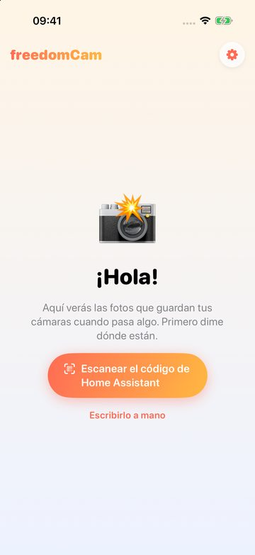
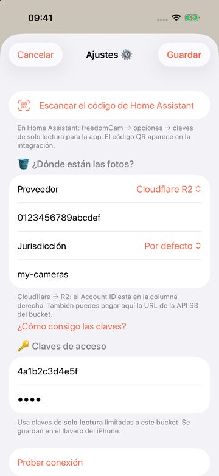
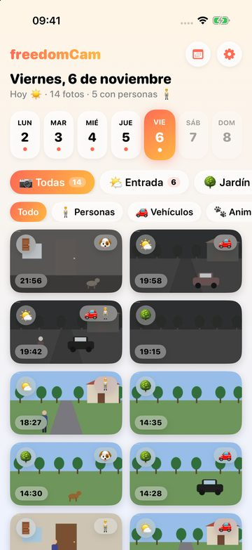
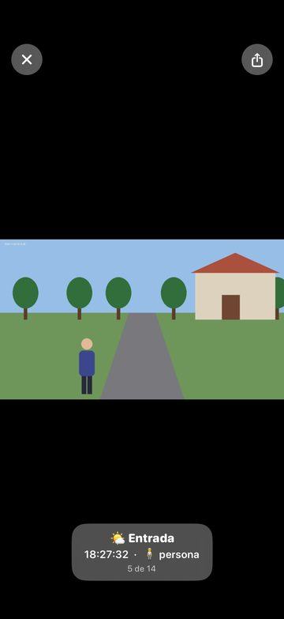

# Guía de uso de freedomCam

*[Read in English](guide.md)*

freedomCam guarda una foto cuando tus cámaras ven movimiento y la deja en **tu propio** almacenamiento. La app
de iOS te enseña esas fotos por día. Nadie más (ni siquiera los autores de freedomCam) puede verlas.

```
cámaras ──► Home Assistant + freedomCam ──► tu bucket S3 ◄── app freedomCam (iPhone)
             (escribe)                                       (solo lee)
```

1. [Qué necesitas](#1-qué-necesitas)
2. [Crear el almacenamiento](#2-crear-el-almacenamiento)
3. [Instalar la integración](#3-instalar-la-integración)
4. [Conectar el almacenamiento](#4-conectar-el-almacenamiento)
5. [Añadir las cámaras](#5-añadir-las-cámaras)
6. [Opciones](#6-opciones)
7. [Conectar la app del iPhone](#7-conectar-la-app-del-iphone)
8. [Usar la app](#8-usar-la-app)
9. [Costes](#9-costes)
10. [Problemas frecuentes](#10-problemas-frecuentes)

## 1. Qué necesitas

- **Home Assistant** 2025.6 o posterior, con tus cámaras ya añadidas (vale cualquier entidad `camera.*`).
- **Almacenamiento compatible con S3**: Cloudflare R2, Amazon S3, Backblaze B2, Wasabi o el tuyo propio (MinIO, un NAS…).
- **HACS** para instalar la integración.
- Un **iPhone** con iOS 17 o posterior para la app. 📱 *La app estará muy pronto en el App Store.*

## 2. Crear el almacenamiento

Necesitas **un bucket y dos pares de claves**:

| Claves | Las usa | Permisos |
|--------|---------|----------|
| Claves de escritura | Home Assistant | leer y escribir en ese bucket |
| Claves de la app | el iPhone | **solo leer** ese bucket |

Así, si pierdes el móvil, sus claves no pueden borrar ni cambiar nada.

### Cloudflare R2 (recomendado para empezar)

10 GB gratis y sin coste por descargar las fotos al móvil.

1. En el [panel de Cloudflare](https://dash.cloudflare.com/) abre **R2 Object Storage** y actívalo (Cloudflare pide
   una tarjeta aunque uses el plan gratuito).
2. **Create bucket**, por ejemplo `freedomcam`. Deja la ubicación por defecto.
3. Copia tu **Account ID**: aparece en la página de resumen de R2.
4. **Manage API tokens → Create API token**:
   - nombre `freedomcam-ha`, permiso **Object Read & Write**, *Specify bucket* → tu bucket.
   - Copia el **Access Key ID** y el **Secret Access Key**: solo se muestran una vez.
   - Consejo: con **Admin Read & Write** freedomCam puede crear también la regla que borra las fotos antiguas.
5. Crea un segundo token, `freedomcam-app`, con **Object Read only** para el mismo bucket. Guárdalo para el paso 7.

### Otros proveedores

- **Amazon S3**: crea el bucket en tu región y un usuario IAM con `s3:GetObject`, `s3:PutObject`,
  `s3:DeleteObject` y `s3:ListBucket` sobre él; y otro usuario solo con `s3:GetObject` y `s3:ListBucket` para la app.
- **Backblaze B2** (no pide tarjeta para empezar): crea un bucket **privado**. Su endpoint S3
  `s3.<región>.backblazeb2.com` te dice la región. Crea dos *Application Keys* limitadas al bucket: *Read and Write*
  y *Read Only*.
- **Wasabi**: bucket y dos usuarios con políticas limitadas a él.
- **MinIO / NAS / otros**: necesitas la URL de la API S3 (sin el bucket) y, si la tiene, la región.

## 3. Instalar la integración

1. HACS → ⋮ → **Repositorios personalizados** → `https://github.com/javiermugueta/freedomcam`, tipo **Integración**.
2. Busca **freedomCam**, **Descargar**, y reinicia Home Assistant.

## 4. Conectar el almacenamiento

*Ajustes → Dispositivos y servicios → Añadir integración → **freedomCam***. El asistente:

1. Pregunta el **proveedor**.
2. Enseña los pasos de ese proveedor y pide el bucket y las **claves de escritura**. Las comprueba escribiendo,
   leyendo y borrando un fichero de prueba. Si el bucket no existe y las claves lo permiten, lo crea.
3. Pregunta **cuántos días guardar las fotos** (0 = siempre). El propio bucket borra las antiguas, aunque Home
   Assistant esté apagado. Si tus claves no pueden gestionar el bucket, apaga *Que freedomCam cree la regla* y crea
   la regla en la consola de tu proveedor.

## 5. Añadir las cámaras

En la tarjeta de freedomCam, **Añadir cámara** por cada una:

| Campo | Para qué sirve |
|-------|----------------|
| Cámara | la entidad `camera.*` |
| Nombre | el que se ve en la app |
| Carpeta en el bucket | si la dejas vacía se crea a partir del nombre; no se puede cambiar después |
| Ubicación | interior o exterior (las de interior ignoran los coches que se ven por la ventana) |
| Detección de movimiento | **Imagen**: compara cada foto con las anteriores, vale para cualquier cámara. **Sensor de movimiento**: hace fotos mientras un `binary_sensor` detecta movimiento (Tapo, Reolink…) |
| Revisar cada | segundos entre fotos, solo en el modo *Imagen* |
| Solo cuando no hay nadie en casa | usa la entidad de presencia de las opciones |

Cada cámara tiene un sensor **Fotos de hoy**, con la última foto, sus etiquetas y el último error como atributos.

## 6. Opciones

*freedomCam → Configurar*:

- **Entidad de «hay alguien en casa»**: por ejemplo `zone.home` (número de personas en casa), un `input_boolean`,
  una `person` o un grupo. Las cámaras marcadas *solo cuando no hay nadie en casa* funcionan mientras esté en
  `off`, `not_home` o `0`.
- **Tiempo mínimo entre fotos** y **máximo de fotos por hora**: límites para el viento, la lluvia o una calle con mucho paso.
- **Sensibilidad**: cuánto tiene que cambiar la imagen para que cuente como movimiento (modo *Imagen*).
- **Miniaturas**: copias pequeñas que hacen la app rápida y ahorran datos móviles. Déjalo encendido.
- **Detección de objetos** (opcional): con **Cloudflare Workers AI**, cada foto lleva en el nombre lo que aparece,
  p. ej. `181502_car-person.jpg`, y la app puede filtrar personas, vehículos o animales. Crea un token de la API
  de Cloudflare con el permiso *Workers AI* y escríbelo junto a tu Account ID.
- **Claves de la app (solo lectura)**: mira el paso siguiente.

## 7. Conectar la app del iPhone

1. En *freedomCam → Configurar*, escribe las **claves de la app** (las de solo lectura). freedomCam comprueba que
   pueden leer y **las rechaza si pueden escribir**.
2. La integración muestra una imagen nueva, **QR para conectar la app**.
3. En la app, toca **Escanear el código de Home Assistant** y apunta al QR. También puedes leerlo con la app
   Cámara del iPhone: te ofrecerá abrir freedomCam.

Si no tienes Home Assistant a mano, toca **Escribirlo a mano** y rellena proveedor, bucket y claves.
Para curiosear antes, **Probar la demo** enseña una semana de fotos inventadas; *Salir* en su aviso te devuelve al inicio.

<p>


</p>

## 8. Usar la app

<p>


</p>

- La **tira de la semana** marca con un punto los días con fotos. El botón 🗓️ lleva a cualquier fecha.
- Los **botones de cámara** dicen cuántas fotos hizo cada una ese día; toca uno para ver solo esa cámara.
- **Filtros**: personas, vehículos, animales o fotos en las que no se detectó nada.
- Toca una foto para abrirla: desliza para pasar a la siguiente, pellizca o toca dos veces para ampliar, y compártela.
- Las fotos ya vistas se guardan en el móvil y no vuelven a gastar datos. *Ajustes → Vaciar caché* libera el espacio.
- La app sigue el idioma del iPhone (español o inglés).

## 9. Costes

freedomCam es gratis. Solo pagas a tu proveedor de almacenamiento, si pasas de su plan gratuito:

- **Cloudflare R2**: 10 GB guardados, 1 millón de escrituras y 10 millones de lecturas al mes gratis; las
  descargas son gratis. Una foto suele ocupar 100–300 KB, así que 30 días de unos cientos de fotos diarias caben de sobra.
- **Workers AI** (opcional): tiene una cuota diaria gratuita; mira los precios de Cloudflare para tu volumen.

Los límites de *fotos por hora* y *días que se guardan las fotos* mantienen el tamaño bajo control.

## 10. Problemas frecuentes

| Mensaje | Qué hacer |
|---------|-----------|
| Las claves no son válidas | Vuelve a copiarlas; en S3, B2 y Wasabi revisa también la región |
| Las claves funcionan pero no pueden escribir | Da a las claves de escritura permiso de lectura y escritura en el bucket |
| El bucket no existe y estas claves no pueden crearlo | Crea el bucket en la consola de tu proveedor |
| Estas claves no pueden gestionar las reglas del bucket | Apaga la opción y crea la regla de caducidad en la consola |
| Las claves de la app pueden ESCRIBIR en el bucket | Crea claves de solo lectura para la app |
| *Fotos de hoy* se queda en 0 | Mira el atributo `error` del sensor; con *Solo cuando no hay nadie en casa*, revisa la entidad de presencia |
| App: «El almacenamiento no me deja entrar (403)» | Las claves de la app o la región están mal, o se borraron las claves |

Dudas o problemas: [abre una incidencia](https://github.com/javiermugueta/freedomcam/issues).
