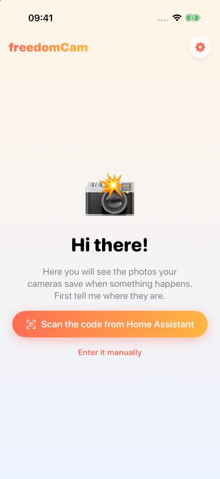
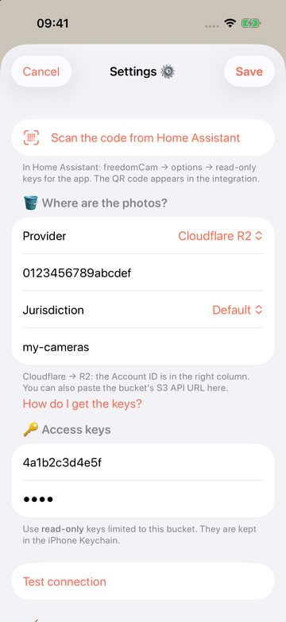
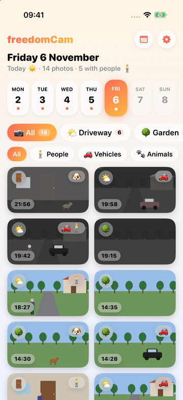
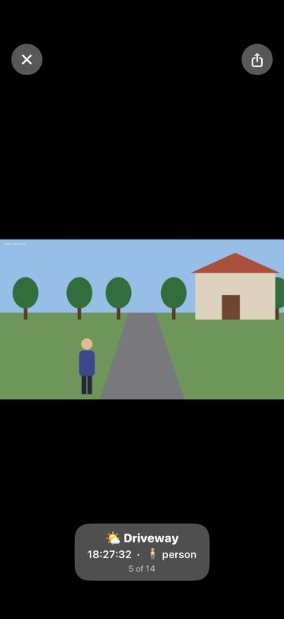

# freedomCam user guide

*[Leer en español](guide.es.md)*

freedomCam saves a photo when your cameras see movement and keeps it in **your own** storage. The iOS app
shows those photos by day. Nobody else (not even the authors of freedomCam) can see them.

```
cameras ──► Home Assistant + freedomCam ──► your S3 bucket ◄── freedomCam app (iPhone)
             (writes)                                          (reads only)
```

1. [What you need](#1-what-you-need)
2. [Create the storage](#2-create-the-storage)
3. [Install the integration](#3-install-the-integration)
4. [Connect the storage](#4-connect-the-storage)
5. [Add your cameras](#5-add-your-cameras)
6. [Options](#6-options)
7. [Connect the iPhone app](#7-connect-the-iphone-app)
8. [Using the app](#8-using-the-app)
9. [Costs](#9-costs)
10. [Troubleshooting](#10-troubleshooting)

## 1. What you need

- **Home Assistant** 2025.6 or newer, with your cameras already added (any `camera.*` entity works).
- **S3-compatible storage**: Cloudflare R2, Amazon S3, Backblaze B2, Wasabi, or your own (MinIO, a NAS…).
- **HACS** to install the integration.
- An **iPhone** with iOS 17 or newer for the app. 📱 *The app is coming soon to the App Store.*

## 2. Create the storage

You need **one bucket and two pairs of keys**:

| Keys | Used by | Permissions |
|------|---------|-------------|
| Writer keys | Home Assistant | read and write that bucket |
| App keys | the iPhone | **read only** that bucket |

If the phone is ever lost, its keys cannot delete or change anything.

### Cloudflare R2 (recommended to start)

10 GB free and no charge for downloading photos to your phone.

1. In the [Cloudflare dashboard](https://dash.cloudflare.com/) open **R2 Object Storage** and activate it
   (Cloudflare asks for a payment card even on the free plan).
2. **Create bucket**, for example `freedomcam`. Keep the default location.
3. Copy your **Account ID**: it is shown on the R2 overview page.
4. **Manage API tokens → Create API token**:
   - name `freedomcam-ha`, permission **Object Read & Write**, *Specify bucket* → your bucket.
   - Copy the **Access Key ID** and the **Secret Access Key**: they are shown only once.
   - Tip: with **Admin Read & Write** freedomCam can also create the rule that deletes old photos.
5. Create a second token, `freedomcam-app`, with **Object Read only** for the same bucket. Keep it for step 7.

### Other providers

- **Amazon S3**: create the bucket in your region and an IAM user with `s3:GetObject`, `s3:PutObject`,
  `s3:DeleteObject` and `s3:ListBucket` on it; a second user with only `s3:GetObject` and `s3:ListBucket`
  for the app.
- **Backblaze B2** (no card needed to start): create a **private** bucket. Its S3 endpoint
  `s3.<region>.backblazeb2.com` tells you the region. Create two *Application Keys* limited to the bucket:
  *Read and Write*, and *Read Only*.
- **Wasabi**: bucket plus two users with policies limited to it.
- **MinIO / NAS / others**: you need the S3 API URL (without the bucket) and, if it has one, the region.

## 3. Install the integration

1. HACS → ⋮ → **Custom repositories** → `https://github.com/javiermugueta/freedomcam`, type **Integration**.
2. Search **freedomCam**, **Download**, and restart Home Assistant.

## 4. Connect the storage

*Settings → Devices & services → Add integration → **freedomCam***. The wizard:

1. Asks for the **provider**.
2. Shows the steps for that provider and asks for the bucket and the **writer keys**. It checks them by
   writing, reading and deleting a small test file. If the bucket does not exist and the keys allow it,
   it creates it.
3. Asks **how many days to keep photos** (0 = forever). The bucket deletes old photos by itself, even if
   Home Assistant is off. If your keys cannot manage the bucket, turn off *Let freedomCam set the rule* and
   create the rule in your provider's console.

## 5. Add your cameras

In the freedomCam card, **Add camera** for each one:

| Field | What it does |
|-------|--------------|
| Camera | the `camera.*` entity |
| Name | shown in the app |
| Folder in the bucket | made from the name if empty; it cannot be changed later |
| Location | indoor or outdoor (indoor cameras ignore cars seen through windows) |
| Motion detection | **Image**: compares each snapshot with the previous ones, works with any camera. **Motion sensor**: takes photos while a `binary_sensor` reports motion (Tapo, Reolink…) |
| Check every | seconds between snapshots, *Image* mode only |
| Only when nobody is home | uses the presence entity of the options |

Each camera gets a **Photos today** sensor, with the last photo, its labels and the last error as attributes.

## 6. Options

*freedomCam → Configure*:

- **Someone-at-home entity**: for example `zone.home` (number of people at home), an `input_boolean`, a
  `person` or a group. Cameras marked *only when nobody is home* work while it is `off`, `not_home` or `0`.
- **Minimum time between photos** and **maximum photos per hour**: limits for wind, rain or a busy street.
- **Sensitivity**: how much of the image must change to count as movement (*Image* mode).
- **Thumbnails**: small copies that make the app fast and save mobile data. Leave it on.
- **Object detection** (optional): with **Cloudflare Workers AI**, each photo is named after what it shows,
  e.g. `181502_car-person.jpg`, and the app can filter people, vehicles or animals. Create a Cloudflare API
  token with the *Workers AI* permission and enter it with your Account ID.
- **App keys (read-only)**: see the next step.

## 7. Connect the iPhone app

1. In *freedomCam → Configure*, enter the **app keys** (the read-only ones). freedomCam checks that they
   can read and **refuses them if they can write**.
2. The integration shows a new image, **App connection QR**.
3. In the app, tap **Scan the code from Home Assistant** and point at the QR. You can also scan it with the
   iPhone Camera app: it offers to open freedomCam.

Without Home Assistant at hand, tap **Enter it manually** and fill in the provider, bucket and keys.
To look around first, **Try the demo** shows a week of made-up photos; *Exit* in its banner goes back.

<p>


</p>

## 8. Using the app

<p>


</p>

- The **week strip** shows a dot on days with photos. The 🗓️ button goes to any date.
- **Camera chips** show how many photos each camera took that day; tap one to see only that camera.
- **Filters**: people, vehicles, animals, or photos where nothing was detected.
- Tap a photo to open it: swipe to go to the next one, pinch or double-tap to zoom, and share it.
- Photos already seen are kept on the phone and use no data again. *Settings → Empty cache* frees the space.
- The app follows the iPhone language (English or Spanish).

## 9. Costs

freedomCam is free. You only pay your storage provider, if you go over its free tier:

- **Cloudflare R2**: 10 GB stored, 1 million writes and 10 million reads per month for free; downloads are
  free. A photo is usually 100–300 KB, so 30 days of a few hundred photos a day fit easily.
- **Workers AI** (optional): has a daily free allowance; see Cloudflare's pricing for your volume.

The limits *photos per hour* and *days to keep photos* keep the size under control.

## 10. Troubleshooting

| Message | What to do |
|---------|------------|
| The keys are not valid | Copy them again; for S3, B2 and Wasabi check the region too |
| The keys work but cannot write | Give the writer keys read and write permission on the bucket |
| The bucket does not exist and these keys cannot create it | Create the bucket in your provider's console |
| These keys cannot manage the bucket rules | Turn off the option and create the retention rule in the console |
| The app keys can WRITE to the bucket | Create read-only keys for the app |
| *Photos today* stays at 0 | Look at the `error` attribute of the sensor; for *Only when nobody is home*, check the presence entity |
| App: “The storage does not let me in (403)” | The app keys or the region are wrong, or the keys were deleted |

Questions or problems: [open an issue](https://github.com/javiermugueta/freedomcam/issues).
